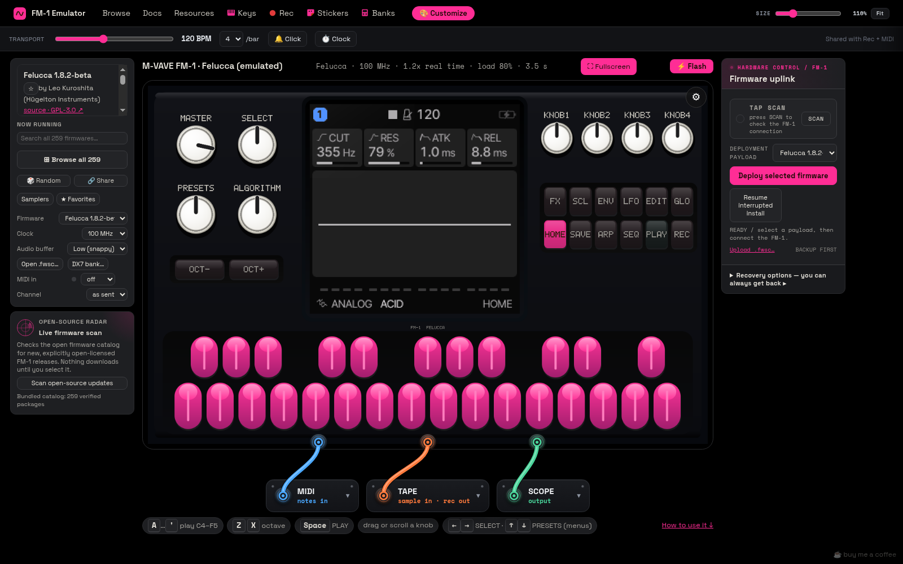
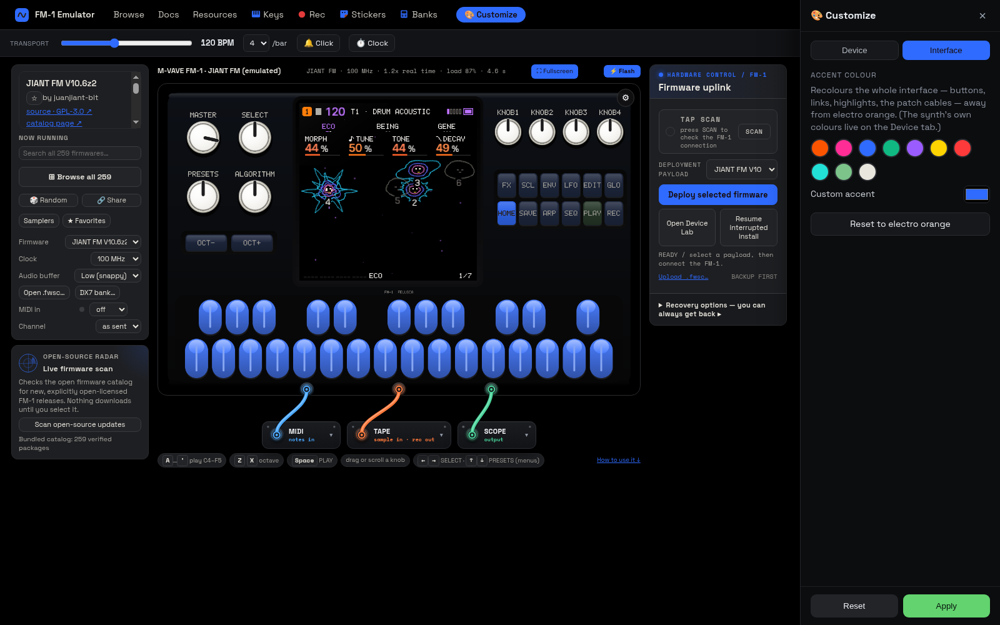
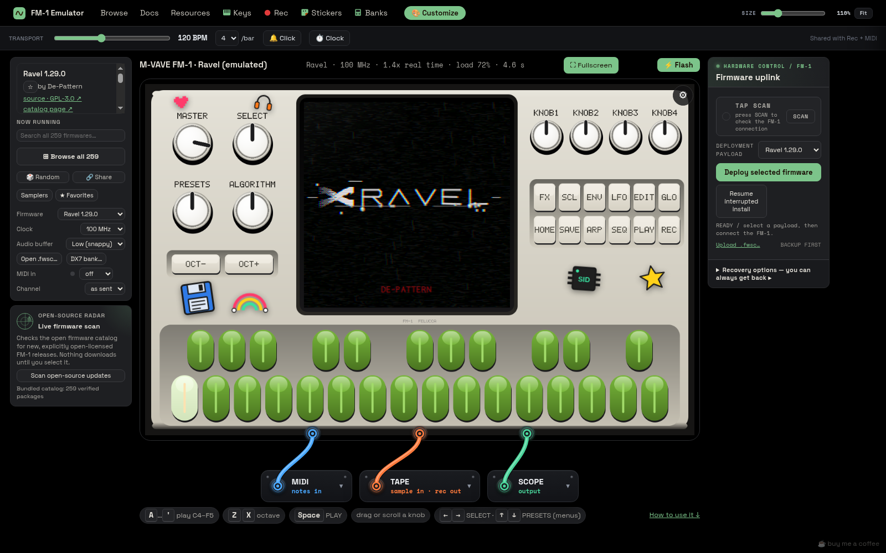
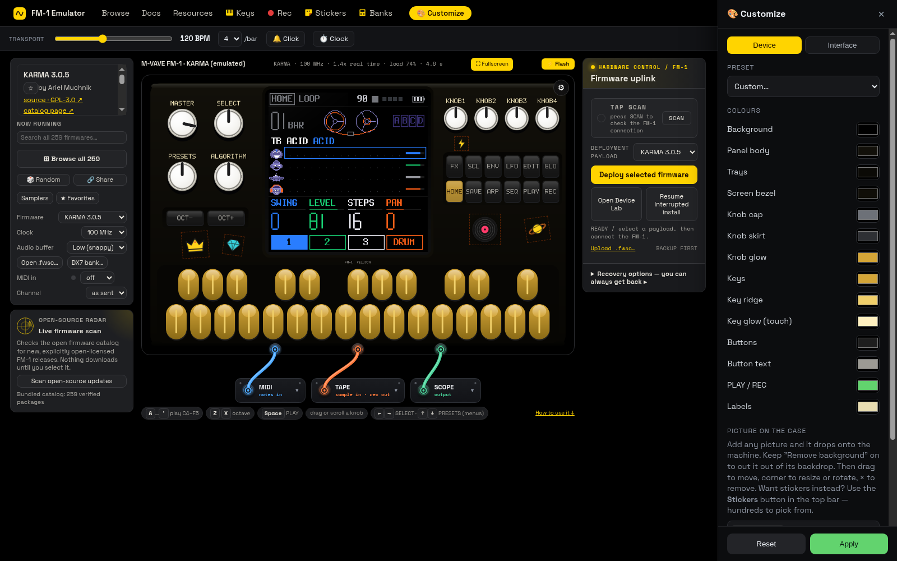
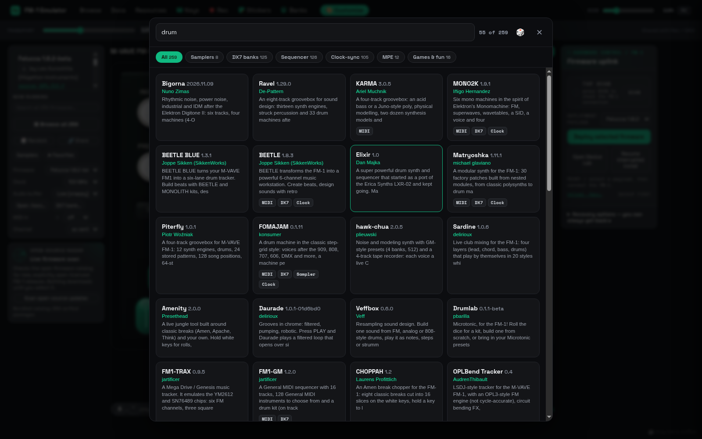
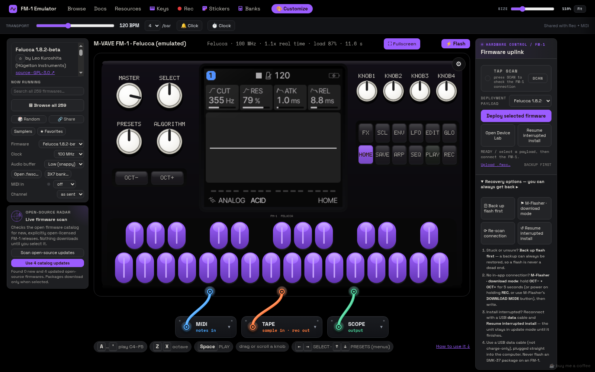
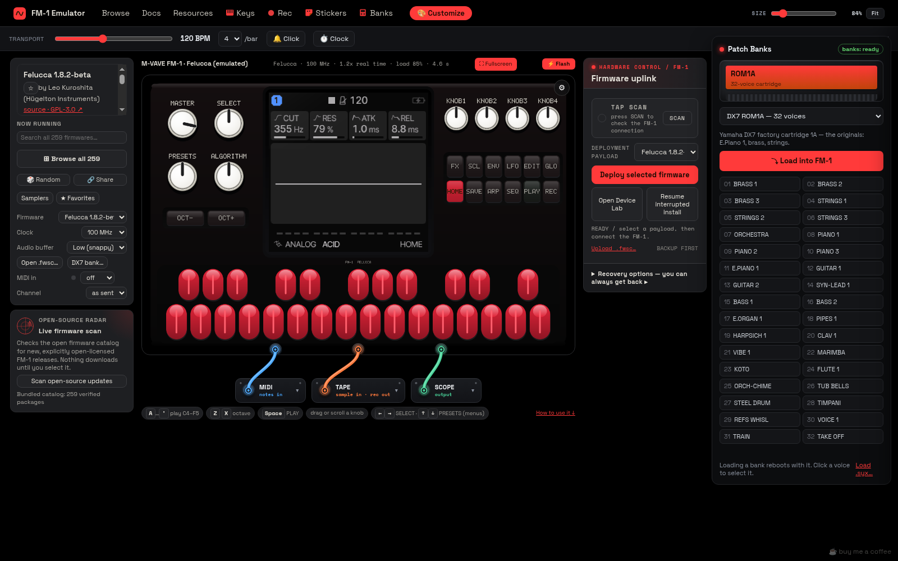
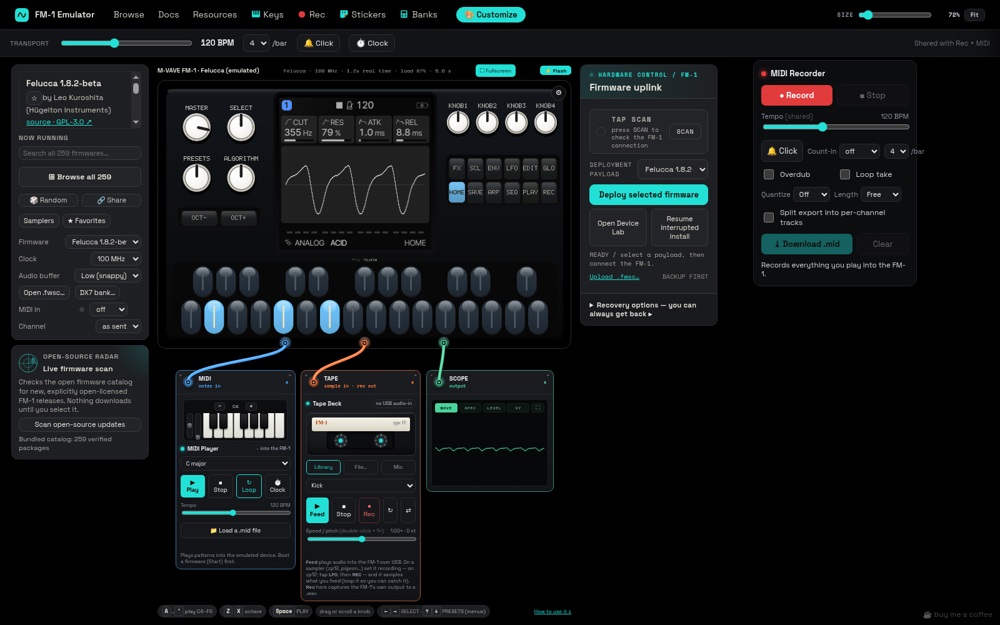
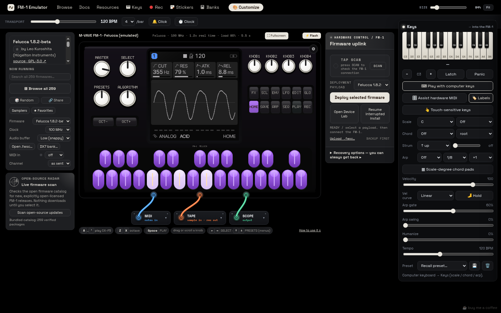

<div align="center">

# FM-1 Emulator

### Find, try, flash, and recover firmware for the M-VAVE FM-1.

[](https://github.com/briksquared/fm1-emulator/releases/latest)
[](https://github.com/briksquared/fm1-emulator/releases)
[](LICENSE)




</div>

---

The FM-1 has a huge community firmware scene, and this app is the easy way into it. It ships with
**259 open-source FM-1 firmwares**, lets you search them and spot new releases, and runs any of them
in a faithful emulator so you can **try a firmware before it goes anywhere near your unit**. When
you find one you like, flash it to your real FM-1 over USB from the same window. **Flash any
firmware to your FM-1 in a few clicks, and recover if anything goes wrong.**

## How it works

1. **Find.** Browse or search the bundled library, or let the firmware radar check for newly
   published open-source releases.
2. **Try.** Press **Start** and play the firmware in the emulator with your computer keyboard, the
   mouse, a MIDI controller, or your FM-1 itself.
3. **Flash.** Connect the FM-1 with a USB data cable, pick the firmware in the **Firmware uplink**
   panel, and press **Deploy selected firmware**. The package is checked before a single byte is
   sent, and the app keeps a record of every step of the install.
4. **Recover.** If an install is cut off, the app notices the next time it opens and offers to
   **resume** it or **roll back** to the firmware you had before. On Windows, the bundled M-Flasher
   backs up, restores, and reinstalls the whole flash.

## Screenshots

| | |
| --- | --- |
|  |  |
|  |  |
|  |  |
|  |  |
|  |  |

## Features

### Firmware library
- **259 open-source firmwares bundled**, newest first, every one boot-checked and SHA-256 verified,
  all available offline
- **Search** by name, author, version, license, product identity, or description (try "drum",
  "bass", "ambient"), plus **Samplers** and **Favorites** filters and a full **Browse all** view
- **Open-source firmware radar**: one button scans for newly published open-license FM-1 releases; nothing
  downloads until you pick one
- **Load your own**: open or drag in any `.fwsc` package, including M-VAVE's stock firmware

### Try before you flash
- The FM-1's chip, screen, keys, knobs, and audio emulated in software, running the same update
  packages you would install on the hardware
- Each firmware's card says how to drive it (*Plays MIDI*, *DX7 banks*, *Sampler*, *Clock-sync*)
- The emulator can't touch your FM-1 or your computer, so trying a firmware carries no risk

### Flash and recover
- **Firmware uplink**: scan for the connected FM-1, pick any bundled firmware or your own `.fwsc`,
  and deploy it over USB-MIDI (desktop app, or Chrome and Edge)
- **Checked before it's written**: every package's size, FM-1 product identity, and published
  SHA-256 are verified first, and the unit's identity is checked again after it restarts
- **A confirmation step** names the firmware and the unit before anything is sent, with a reminder
  to back up the flash first
- **Install journal**: each step of a flash is recorded, so an install interrupted by an unplugged
  cable, a closed window, or a crash is picked up the next time the app opens
- **Resume or roll back**: finish the interrupted install, or put back the last firmware that
  installed cleanly; the unit stays in update mode until one of them completes
- **Retries and timeouts** on every USB-MIDI step, and a warning if you try to close the app
  mid-flash
- **Windows:** the bundled **M-Flasher** backs up, restores, and reinstalls the whole flash, and
  reaches a unit in download mode when nothing else can
- Step-by-step recovery guide in the app and in [docs/Recovery.md](docs/Recovery.md)

### Play
- Computer keyboard, mouse, or any USB MIDI controller; plug in your real FM-1 and the desktop app
  picks it as the MIDI input so its keys play the emulator (see below)
- **Smooth audio**: the emulator runs on its own thread, separate from audio output, so playback
  stays clean on Apple Silicon and other fast machines; a dropout, if one happens, shows as a
  small notice in the toolbar
- **Keys** module with scales, chords, and an arpeggiator, a MIDI file player, and a scope
- **Rec** records what you play to a `.mid` file; the **Tape** deck records the FM-1's output to
  `.wav` and feeds samples into firmwares that take audio in
- **DX7 banks** for DX7-capable firmwares
- **Customize** the case with presets of the real FM-1 colourways and many more, your own pictures,
  and hundreds of **stickers**
- **Interface themes**: dark and light themes for the app itself (Midnight, Graphite, Cobalt,
  Emerald, Crimson, Vaporwave, Ice, Paper), or pick your own background, panel, control, text, and
  accent colours; text contrast is kept readable

### Stays up to date
- **In-app updates**: the desktop app checks GitHub Releases and tells you when a new version is
  out. The Windows installer and the AppImage download and install it on restart; macOS, `.deb`,
  and portable builds link straight to the right download
- **Clean upgrades**: install a new version over the old one with no uninstall; favorites, saved
  firmware, and settings are kept

## Control it with your real FM-1

Plug your FM-1 into the computer over USB and pick it under **MIDI in** (the desktop app selects
a connected FM-1, M-VAVE or SMK-37 input by itself the first time). Everything the hardware sends
then goes into the emulated FM-1's MIDI IN, the same as a cable into a real one:

- **Notes** from the keys play the emulated firmware.
- **Controllers, pitch bend and MIDI clock / start / stop** are passed through unchanged; what they
  do is up to the firmware running in the emulator (see each firmware's *Plays MIDI* and
  *Clock-sync* tags).
- **Channel** next to MIDI in moves every note and controller to one channel, for firmwares that
  listen on a fixed one (M-VAVE's own firmware: channel 2).

What reaches the emulator is whatever the firmware on your physical FM-1 sends over USB: knob moves
arrive only if that firmware sends them as MIDI controllers, and they are not mirrored onto the
emulated knobs. SysEx is not passed through. Safari has no Web MIDI; the desktop app and Chrome,
Edge and Firefox do.

## Download

Get the latest build for your system from the [**Releases**](https://github.com/briksquared/fm1-emulator/releases/latest) page.

| OS | File |
| --- | --- |
| **Windows** | `FM-1-Emulator-Setup-*.exe` (installer) or `*-portable.exe` (no install) |
| **macOS** | `*-arm64.dmg` (Apple Silicon) · `*-x64.dmg` (Intel) |
| **Linux** | `*.AppImage` or `*.deb` |

## First launch

The builds aren't code-signed, so your OS shows a **one-time warning** the first time. It's safe —
here's how to get past it:

- **macOS** — right-click (or Control-click) the app → **Open** → **Open**. (A double-click only shows
  a *Cancel* button; right-clicking gives you the **Open** button.) If it says **"damaged"**, run in
  Terminal: `xattr -dr com.apple.quarantine "/Applications/FM-1 Emulator.app"` then
  `codesign --force --deep --sign - "/Applications/FM-1 Emulator.app"`.
- **Windows** — if SmartScreen appears, click **More info → Run anyway**.
- **Linux** — the `.deb` is easiest. For the AppImage, if it won't start: `sudo apt install libfuse2`
  (Ubuntu 24.04: `libfuse2t64`), and on Ubuntu 24.04 run with `--no-sandbox` if you hit a sandbox error.

Full per-platform detail, including upgrading: **[Installation & first run](docs/Installation.md)**.

## Help

- **[Installation & first run](docs/Installation.md)** — the unsigned-app warning on Windows, macOS, and Linux
- **[Troubleshooting](docs/Troubleshooting.md)** — no sound, MIDI not detected, a firmware won't boot, settings not saving
- **[Firmware](docs/Firmware.md)** — switching firmware and loading your own `.fwsc`
- **[Hardware flashing & recovery](docs/Recovery.md)** — flashing a real FM-1 and getting back from a failed install

## Firmware & licensing

Only firmwares published under a clear redistributable open-source license, with available source
and a passing emulator boot audit, are bundled. The 259 packages use GPL, MPL, or another compatible
open license and are redistributed unchanged with credit — see [THIRD-PARTY.md](THIRD-PARTY.md) and
the exact hashes in [FIRMWARE-SOURCES.json](FIRMWARE-SOURCES.json). Packages with missing or
unverifiable licensing, restricted media, a wrong-device identity, or a failed boot check stay out.
The M-VAVE stock firmware is not bundled; load your own `.fwsc` to run it.

## Build from source

Requires [Node.js](https://nodejs.org) 18+.

```bash
git clone https://github.com/briksquared/fm1-emulator.git
cd fm1-emulator
npm install
npm start            # run it
npm run dist:win     # or dist:mac / dist:linux to package
```

Release builds for all three platforms are produced by GitHub Actions on each tag.

Maintainers can refresh the bundled open-source set with `npm run sync:firmwares`; the command
verifies every SHA-256 hash and FM-1 product identity and removes superseded package files.
Run `npm run audit:firmwares -- --out <directory>` to boot every package in an isolated emulator,
check for CPU halts or blank LCDs, and write a machine-readable report plus LCD captures.

## Credits

A fork of [fm1-emu](https://github.com/joakimeriksson/fm1-emu) by Joakim Eriksson (MIT), which
provides the Rust→WebAssembly emulation engine. Firmware by the authors listed in
[THIRD-PARTY.md](THIRD-PARTY.md).

## License

[MIT](LICENSE). See [NOTICE.md](NOTICE.md) for the fork, bundled-firmware, and trademark notices.
Unofficial — not affiliated with, authorized by, or endorsed by M-VAVE. See [DISCLAIMER.md](DISCLAIMER.md).
