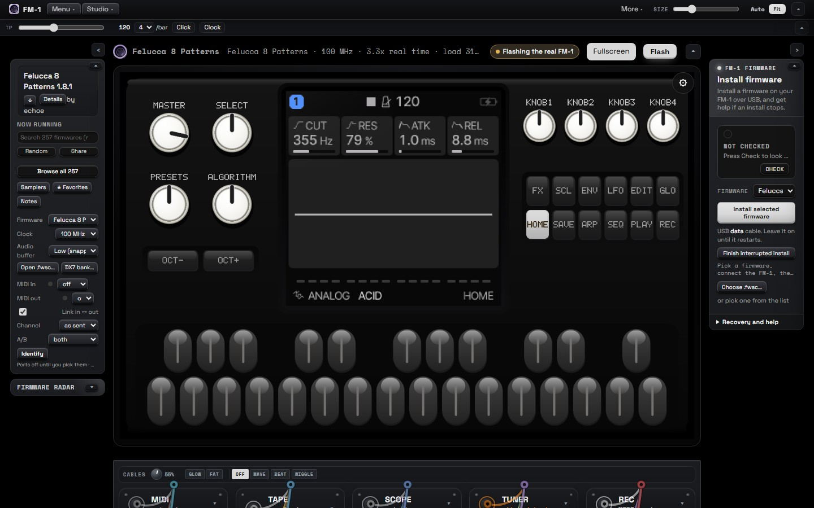

<div align="center">

# FM-1 Emulator

An offline desktop emulator for the **M-VAVE FM-1**. Run FM-1 firmware with no hardware:
choose a firmware, press **Start**, and play with your keyboard, mouse, or a MIDI controller.

[](https://github.com/briksquared/fm1-emulator/releases/latest)
[](https://github.com/briksquared/fm1-emulator/releases)
[](LICENSE)




</div>

---

## Download

Get the latest build for your system from the [**Releases**](https://github.com/briksquared/fm1-emulator/releases/latest) page.

| OS | File |
| --- | --- |
| **Windows** | `FM-1-Emulator-Setup-*.exe` (installer) or `*-portable.exe` (no install) |
| **macOS** | `*-arm64.dmg` (Apple Silicon) · `*-x64.dmg` (Intel) |
| **Linux** | `*.AppImage` or `*.deb` |

## First launch

The builds aren't code-signed, so your OS shows a **one-time warning** the first time. It's safe —
here's how to get past it:

- **macOS** — right-click (or Control-click) the app → **Open** → **Open**. (A double-click only shows
  a *Cancel* button; right-clicking gives you the **Open** button.) If it says **"damaged"**, run in
  Terminal: `xattr -dr com.apple.quarantine "/Applications/FM-1 Emulator.app"` then
  `codesign --force --deep --sign - "/Applications/FM-1 Emulator.app"`.
- **Windows** — if SmartScreen appears, click **More info → Run anyway**.
- **Linux** — the `.deb` is easiest. For the AppImage, if it won't start: `sudo apt install libfuse2`
  (Ubuntu 24.04: `libfuse2t64`), and on Ubuntu 24.04 run with `--no-sandbox` if you hit a sandbox error.

Full per-platform detail: **[Installation & first run](docs/Installation.md)**.

## Features

- **115 open-source firmwares bundled** — runs fully offline
- **Load your own** — drag any `.fwsc` onto the window
- **Play** with the computer keyboard, mouse, or a USB MIDI controller
- **Customize** panel colors and add image decals; decorate the case with stickers
- **Firmware recovery (Windows)** — back up, restore, and reinstall your FM-1; a flash is never a dead end

## Recovery & safety

The emulator runs firmware purely in software — it cannot harm your computer or your FM-1. The only
risk is flashing real hardware, and the app is built so you can always recover: back up the unit's
flash in one click, resume an interrupted install, or restore with the bundled M-Flasher (Windows).
See **[Hardware flashing & recovery](docs/Recovery.md)**.

## Help

- **[Installation & first run](docs/Installation.md)** — the unsigned-app warning on Windows, macOS, and Linux
- **[Troubleshooting](docs/Troubleshooting.md)** — no sound, MIDI not detected, a firmware won't boot, settings not saving
- **[Firmware](docs/Firmware.md)** — switching firmware and loading your own `.fwsc`
- **[Hardware flashing & recovery](docs/Recovery.md)** — for a real FM-1 unit

## Firmware & licensing

Only firmwares published under a clear open-source license are bundled (all 115 are GPL-3.0),
redistributed unchanged with credit — see [THIRD-PARTY.md](THIRD-PARTY.md). The M-VAVE stock
firmware and firmwares without a stated license are not bundled; load any `.fwsc` yourself to run it.

## Build from source

Requires [Node.js](https://nodejs.org) 18+.

```bash
git clone https://github.com/briksquared/fm1-emulator.git
cd fm1-emulator
npm install
npm start            # run it
npm run dist:win     # or dist:mac / dist:linux to package
```

Release builds for all three platforms are produced by GitHub Actions on each tag.

## Credits

A fork of [fm1-emu](https://github.com/joakimeriksson/fm1-emu) by Joakim Eriksson (MIT), which
provides the Rust→WebAssembly emulation engine. Firmware by the authors listed in
[THIRD-PARTY.md](THIRD-PARTY.md).

## License

[MIT](LICENSE). See [NOTICE.md](NOTICE.md) for the fork, bundled-firmware, and trademark notices.
Unofficial — not affiliated with, authorized by, or endorsed by M-VAVE. See [DISCLAIMER.md](DISCLAIMER.md).
